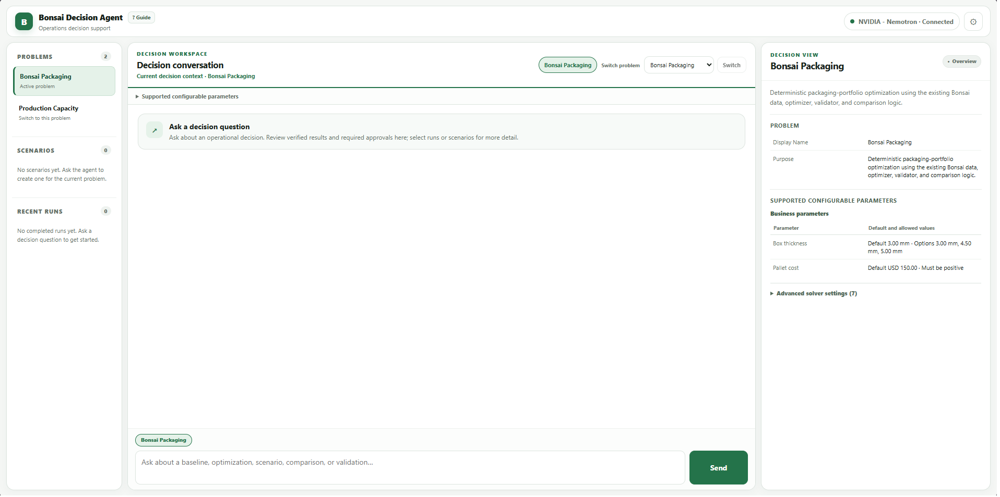
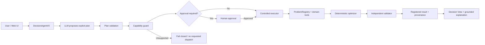
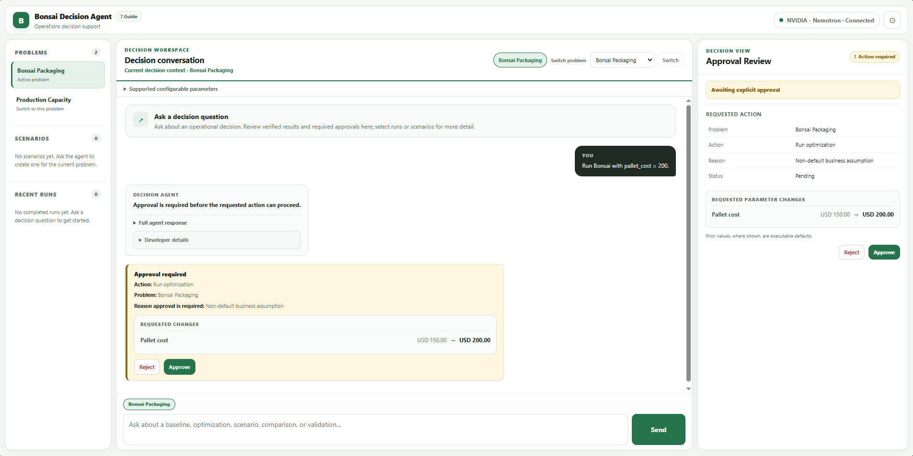
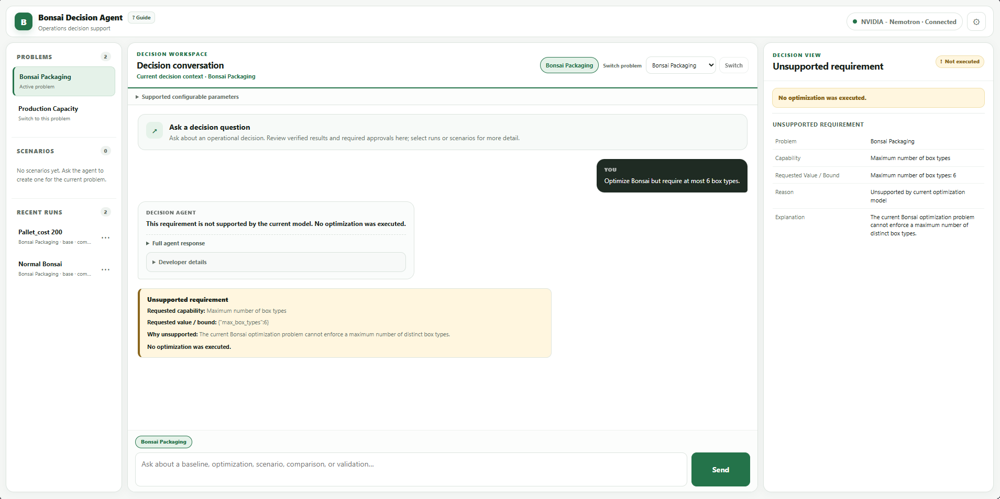
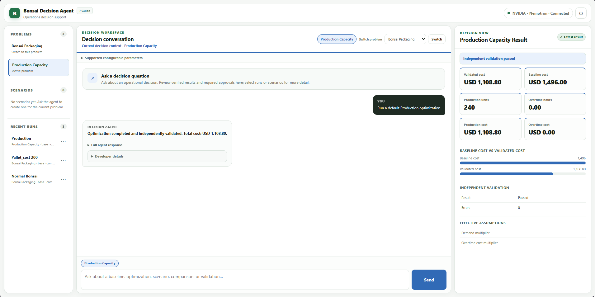

# Bonsai Decision Agent

**Agentic decision support with deterministic optimization and validation.**  
A local application that turns natural-language business requests into controlled optimization workflows, validated results, and inspectable decisions.

The project began as a deterministic solution to the **AlixPartners Bonsai packaging optimization challenge** and evolved into a reusable decision-agent architecture with two domains: **Bonsai Packaging** and **Production Capacity Planning**.

The central engineering idea is simple:

> **The language model proposes what to do; deterministic code controls what can happen and computes the result.**



## Why this project matters

Many agent demos stop at text generation or let an LLM dispatch tools directly. This project uses a stricter boundary between probabilistic reasoning and business execution:

- the model interprets intent and proposes an explicit plan;
- deterministic validation checks that plan before execution;
- unsupported required capabilities fail closed;
- non-default actions can require explicit human approval;
- domain tools run deterministic optimization code;
- an independent validator checks produced solutions;
- results, assumptions, approvals, and execution state remain inspectable in the UI.

The result is a decision-support application rather than a chatbot wrapped around a solver.

## What it can do

### Bonsai Packaging

Optimize a packaging portfolio using the original Bonsai challenge data and deterministic optimization/validation logic. The agent can inspect baselines, run supported parameter variations, manage scenarios, validate solutions, compare compatible results, and surface unsupported requests before execution.

### Production Capacity Planning

A second deterministic domain demonstrates that the orchestration architecture is not tied to the Bonsai problem. It allocates regular and overtime production across compatible product-line pairs while respecting demand and supported planning assumptions.

### Shared decision workflow

Across both domains, the application supports:

- natural-language requests;
- explicit problem switching;
- configurable business assumptions;
- approval-gated non-default actions;
- scenarios and recent runs;
- structured Decision View results;
- historical inspection without rerunning the LLM or optimizer;
- technical **Developer details** for plans, traces, approvals, and provenance.

## How it works



This is a **single-agent architecture**, not a multi-agent system. The LLM participates in planning and explanation; it does not own numerical optimization, execution permission, or independent validation.

For a deeper technical view, see [Architecture](docs/ARCHITECTURE.md) and [Design decisions](docs/DESIGN_DECISIONS.md).

## Product snapshots

### Human approval for a non-default assumption

A request such as `Run Bonsai with pallet_cost = 200.` is prepared first and paused for explicit review. The UI shows the assumption change before execution.



### Fail-closed capability handling

If a required constraint is not implemented by the deterministic model, the application does not pretend otherwise and does not dispatch the requested optimization.



### Second decision domain

Production Capacity Planning uses the same agent control flow with a separate deterministic problem definition, optimizer, validator, assumptions, and result view.



## Interface

The application uses three complementary surfaces:

- **Workspace** — select the active problem, inspect scenarios, and open recent runs.
- **Conversation** — ask decision questions, request optimizations, and review approval/capability states.
- **Decision View** — inspect validated results, assumptions, comparisons, approvals, errors, and historical runs.

A title-adjacent **? Guide** explains the workflow. **Developer details** keeps technical execution information available without making it the default business-facing experience.

Connection profiles support **NVIDIA**, **OpenAI**, and **Custom OpenAI-compatible** endpoints. API keys are stored server-side under the local `data/` directory and are not returned by normal profile reads.

## Run locally

Use an isolated Python environment:

```bash
python -m pip install -r requirements-agent.txt
python run_web_app.py --host 127.0.0.1 --port 8765 --data-dir ./data
```

Then open:

```text
http://127.0.0.1:8765
```

Under **Settings → Connections**:

1. create or select a provider profile;
2. save your API key;
3. fetch available models, or enter a supported model ID manually;
4. choose the model;
5. select **Use Profile**.

The supplied Bonsai challenge data and Production Capacity demo data are included in the repository so the application can run locally without additional datasets.

## Repository structure

| Location | Purpose |
|---|---|
| `webapp/`, `run_web_app.py` | Local HTTP API, connection profiles, presentation layer, and three-panel frontend |
| `bonsai_agent.py` | Single decision-agent orchestration |
| `execution_plan.py`, `execution_control.py`, `capability_guard.py` | Explicit planning, controlled execution, approval/recovery boundaries, and capability enforcement |
| `problem_registry.py`, `*_problem_adapter.py` | Multi-domain registration and adapters |
| `bonsai_core.py`, `bonsai_milp.py`, `run_optimization.py` | Bonsai deterministic optimization |
| `validate_submission.py` | Independent Bonsai validation |
| `production_*.py`, `production_demo/` | Production Capacity Planning demo domain |
| `scenario_store.py`, `run_history.py`, `solution_store.py` | Session-local scenarios, runs, and solution provenance |
| `*.csv` | Bonsai challenge inputs and validated reference data required by the demo |
| `docs/` | Architecture, design decisions, and product screenshots |

## Design boundaries

This repository is intentionally narrower than a production SaaS system:

- only capabilities encoded by each deterministic problem are executable;
- arbitrary new objectives or constraints are not accepted as if already implemented;
- planning and natural-language wording still depend on the configured model provider;
- scenario, solution, and completed-run history is session-local and does not survive a server restart;
- the local web application has no production authentication or multi-user isolation;
- `data/secrets.json` stores API keys as plaintext on the local filesystem and must never be committed;
- Production Capacity Planning is a demonstration of domain generalization, not a production-grade scheduling platform.

These boundaries are deliberate: the project prioritizes controlled execution, traceability, and honest capability limits over pretending the agent can perform unsupported actions.

## Technical deep dives

- [Architecture](docs/ARCHITECTURE.md)
- [Design decisions](docs/DESIGN_DECISIONS.md)

