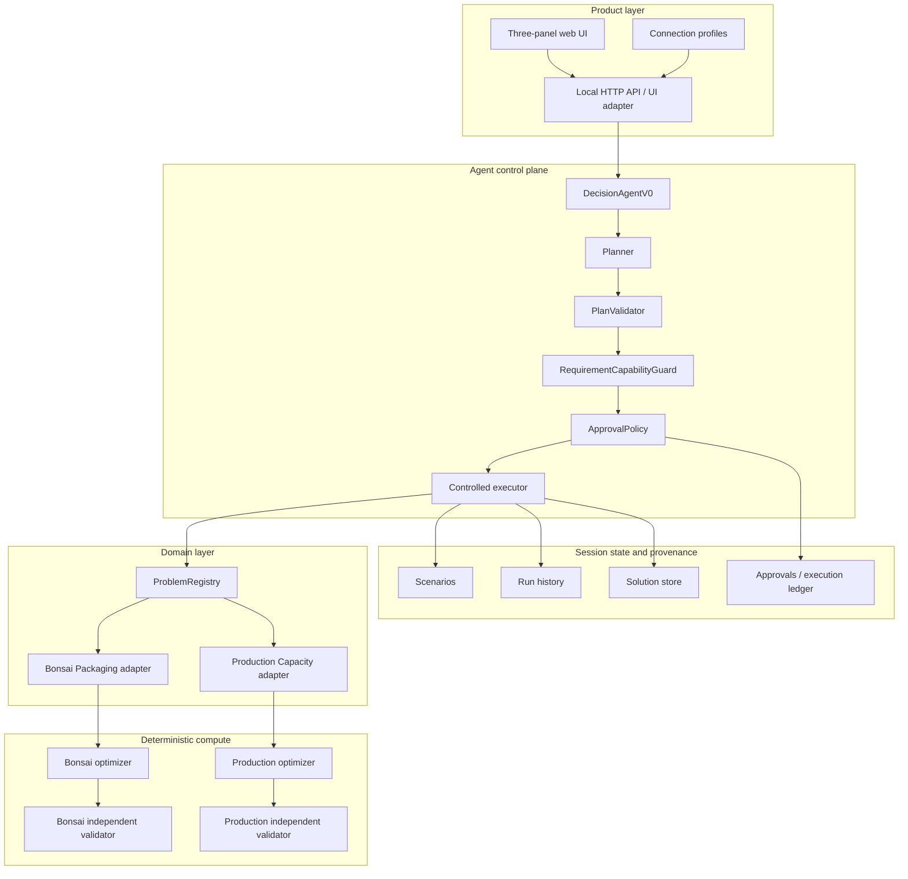
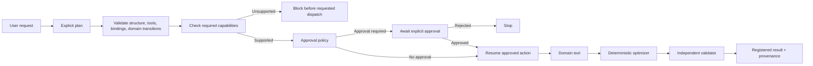
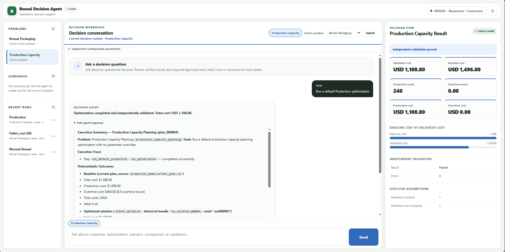

# Architecture

The Bonsai Decision Agent separates probabilistic language reasoning from deterministic business execution.

## High-level structure

## Controlled execution lifecycle

## Responsibilities

### DecisionAgentV0

Coordinates the interaction. It owns neither the optimization mathematics nor final authority over executable constraints.

### Planner

Uses the configured language model to translate a natural-language request into explicit steps and argument bindings.

### PlanValidator

Rejects invalid plans before execution: unsupported tool transitions, malformed bindings, or unsafe cross-domain behavior do not silently proceed.

### RequirementCapabilityGuard

Checks whether a required user constraint is actually enforceable by the active deterministic problem. If not, the request fails closed before optimizer dispatch.

### ApprovalPolicy

Non-default protected actions can pause before execution. Approval is bound to the prepared action/state so a later resume does not silently change what the user approved.

### Controlled executor

Dispatches only validated, permitted steps and records execution state. Recovery distinguishes pre-dispatch failures from uncertain post-dispatch outcomes.

### ProblemRegistry

Provides one orchestration surface over separate deterministic domains. Bonsai Packaging and Production Capacity Planning share control-plane behavior without sharing one giant optimization schema.

### Optimizers and independent validators

Each domain contains deterministic computation and a separate validator. The language model never computes authoritative optimization results.

## UI boundary

The web application is a presentation and interaction layer around the accepted agent/core behavior. It provides:

- problem and scenario navigation;
- natural-language conversation;
- approval and capability cards;
- structured Decision View results;
- recent-run inspection;
- connection profiles and model discovery;
- optional Developer details for plans, traces, approvals, and provenance.

The UI does not own optimization rules.

## State and persistence

Scenarios, registered solutions, and completed runs are session-local. Connection-profile metadata and local UI metadata can persist under `data/`, but this is not a durable production database.

API keys are stored in `data/secrets.json` as plaintext on the local filesystem. The application is designed for trusted local use and should not be exposed as a public multi-user service without a separate security/deployment layer.

## Technical inspection in the UI

The business-facing interface keeps execution internals collapsed by default, while **Developer details** can expose the interaction-specific plan, tool trace, execution record, approvals, and ledger when a technical reviewer wants to inspect them.

